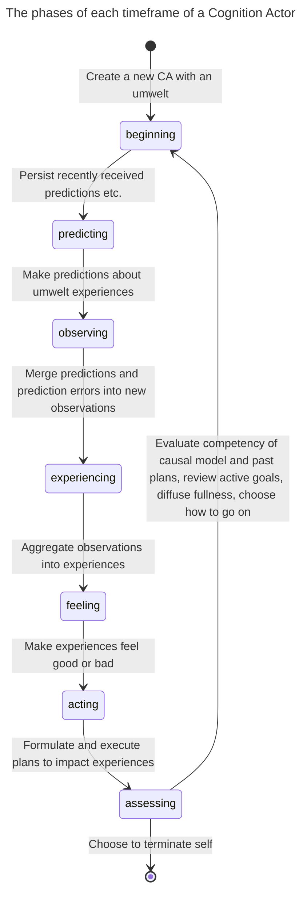
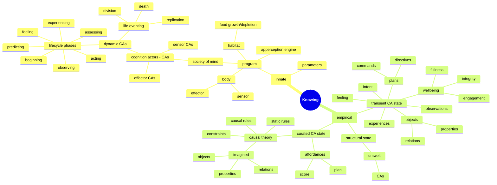

# Symposium 2026 - Who knows

Video deadline is November 7th.

Title: Who knows
Presenter: Jean-François Cloutier, Research Fellow, Active Inference Institute

## Synopsis

The Karma project asks, "How can an autonomous robot learn to survive in a world it initially knows nothing about?"

To answer this question, I am building a cognitive system (enactive, emergent and symbolic) embodied in an autonomous -and mortal- Lego robot. The robot survives in a nourishing and dissipative world by acting-sensing and finding meaning in what it experiences.

The Karma project presents many challenges, technical but also metaphysical. A primary concern is the multiplicity of perspectives on "reality", that of the robot, of its (agentic) environment, of the programmer, and of observers. What can each know, and how? Is a confusion, a cross-contamination of epistemologies inevitable? With "Agentic AI" poised to transform our lives, these questions about knowing matter far beyond the programming of a Lego robot, but they can be illuminated by it.

### Outline

* Project overview
* Knowing
* Epistemic agents
* A confusion of epistemologies
* Knowing better

### Project overview

My Lego robot is autonomous and mortal. Its survival depends on it learning how to reliably find food before it starves, while avoiding damaging itself beyond repair.

The robot has a body and a mind. The body has sensors to read distance, touch, color, wheel torque etc., and it has effectors, motorized wheels, to move about.

The mind is a growing/shrinking/self-organizing society of processes that make sense, together, of a world the robot must engage with to survive.

Each process in the robot's society of mind is a "software actor", that is, a long-lived process that manages its own changing state and interacts with other actors strictly via messages. This Actor Model should feel intuitive as it can be applied to people, neurons, the Web etc.

The software actors composing the robot's society of mind implement the robot's cognition. They will be referred to as Cognition Actors.

There are three kinds of Cognition Actors (CAs): sensor, effector and dynamic cognition actors.

Sensor and effector CAs interface with the body's sensors and effectors. CAs grow and evolve a hierarchy with sensor and effector CAs at the very bottom layer. Dynamic CAs form every other layer. Each dynamic CA has an umwelt (what they can sense and act upon). This umwelt is composed of other (child) CAs one level down. Two CAs can have umwelt CAs in common.

A dynamic CA (henceforth CA unless otherwise specified) observes what its umwelt experiences. It predicts umwelt experiences and then combines *predictions* with *prediction errors* -sent by its umwelt- into *observations*. It finds patterns in these observations and translates these observed patterns into its own experiences. A CA's experiences are then observed by its parent CAs, etc. The CAs thus form an abstraction hierachy.

A CA makes sense of what it observes in its umwelt by developing a *causal theory* (logic rules and constraints) that explains why certain observations change, or not, from one moment to the next. It uses this causal theory to better predict and plan.

The wellbeing of a CA is defined in terms of its fullness (energy reserve), integrity (health level) and engagement (impact on other CAs). Wellness fluctuates over the life of the CA as the robot feeds, collides, collaborates and generally expends energy. Low or declining wellness causes the CA to feel bad. The current feeling of a CA attaches to its experiences, leading to good vs bad experiences. CAs share surplus fullness with their entourage (umwelt and parent CAs) so that the pains and gains of one are eventually felt by all, creating a sort of cognitive glue.

A CA *acts* by persisting or terminating its experiences, one at a time, because of how the experiences feel. The CA does it by formulating a plan by which it directs its umwelt/child CAs to change some of their own experiences, experiences the CA observed and translated into the experience it currently wants to persist or terminate. The child CAs formulate their own plans for impacting their own experiences in the service of the parent CA, and so on until an umwelt contains effector CAs to which commands are sent to turn wheels (perhaps avoiding a collision or positioning the robot over food).

When the robot is first activated, its society of mind begins with a set of sensor CAs (one for each sensor in the robot's body) and effector CAs (one for each effector in the robot's body). They form a permanent bottom layer. A second layer is immediately seeded with a dynamic CA that has all of the first layer CAs as its umwelt. Over time, this first dynamic CA replicates and divides, populating the second layer with randomly "specialized" CAs, each with smaller umwelts. Once the layer is full, a third layer is seeded with a dymanic CA that has the entire second layer as its umwelt, and the process continues. Growth is constrained by how much food (the ultimate source of fullness) the habitat provides, and by the deaths of CAs when their fullness runs out or when their integrity is lost beyond repair. As the society of mind grows and shrinks and grows again, it explores a space of possible organizations, eventually finding one that favors the survival of the collective of CAs. Or the robot dies trying.

For a more detailed account of Karma's cognitive architecure, see last year's presentation at ...

### Knowing

My robot is an epistemic agent. What can it know and how does it know it? I am assuming here that questions of epistemology encompass not just the realm of the living but also of the artificial, including mere Lego robots.

Everything the robot knows, at any point in time, can be located in the state of its collective of Cognition Actors.

Sensor CAs are primitive in that they simply learn what the sensors read. We will focus on dynamic CAs where open-ended cognition happens.

The robot's knowledge is divided into innate vs. empirical knowledge.

#### Innate knowledge

Innate (or a priori) knowledge is programmed in. It is the logic, plus preset parameters, that drives the repeating lifecyle of each CA and each step of this lifecycle.

The steps are:

* beginning       - "house cleaning" at the start of a lifecycle
* predicting      - make predictions from current observations
* observing       - merge predictions and prediction errors into new observations
* experiencing    - integrate current and past observations into terminated, updated and new experiences
* feeling         - assign a normative value (from worst to best feeling) to each experience
* acting          - formulate plans to impact strongly felt experiences and execute them
* assessing       - evaluate the current causal theory, score executed plans as affordances, abandon stale goals and plans, share fullness, move to next life event (replication, division, death, none)

The program does not contain any empirical knowledge, that is, knowledge that can be acquired by the robot through embodied engagement with its habitat, and what a CA learns at each step of its lifecycle is not fully determined by its programming.

The robot's habitat, when run in simulation mode, is itself a program that senses the robot's position and automates the depletion and growth of "food patches" that the robot seeks to replenish itself, while presenting the robot with obstacles also programmed into the habitat.

#### Empirical knowledge

The robot acquires on its own empirical (a posteriori) knowledge, that is, knowledge beyond its programming.

The robot is not pre-loaded with any concept or rule describing its habitat or what it should do in it. There is no pre-training. Furthermore, there is no communication from programmer or observer to assist the robot once it is activated.

The robot's empirical knowledge is a manifold of experiences, feelings, causal models and affordances. This knowledge is distributed among the CAs that compose the robot's society of mind.

Each CA grows empirical knowledge about an umwelt which is itself composed of other CAs that are one level down an abstraction hierarchy.

Experiences are central to knowing. A CA observes the experiences of its umwelt CAs in order to acquire its own experiences from patterns it detects (counts, up or down trends, compared quatities). It then acts to change its own experiences by directing its umwelt CAs to modify their experiences.

Just like a CA's observations are acquired from predictions (of umwelt experiences) and from prediction errors (sent by the umwelt), a CA's actions are executed by predicting changes to umwelt "goal activation" experiences, predictions that cause umwelt CAs to build their own plans and to execute them (also via predictions).

A CA's fluctuating wellbeing changes how the CA feels and whether its current experiences are good ones or bad ones. Feelings modulate attention. A CA directs its attention to the most intensly felt experiences. It sets its intent on persisting the best experiences and terminating the worst ones.

Having set for itself the **goal** of changing a current experience, a CA builds (or reuses) a plan of action. This plan is a sequence of directives, each directive being a goal assigned to the umwelt to persist or terminate an experience the CA observed. A directive can also be a command to carry out an effect (e,g, a reverse-spin of the left wheel) if the CA connects to an effector. How the umwelt CAs realize the goals they are assigned by their parent CAs is up to them (no micro-management!). Umwelt CAs might also give higher priority to self-assigned goals if they consider them more urgent than directives received from parent CAs.

To build an effective plan for impacting one of its (intensely felt) experiences, a CA needs to know two things, 1. which observed umwelt experiences contributed to the experience, and 2. knowing this, which sequence of changes to umwelt experiences is likely to cause the CA's experience to persist or terminate as intended.

A CA can make a good guess from the static analysis of observed umwelt experiences composing the experience it has and wants to change. But this may not be enough. CAs are dynamic and their experiences can change without being directed to. A CA benefits from building a causal theory of how its umwelt changes both when prompted and on its own. A CA makes use of a causal model of its umwelt to build plans that are more likely to succeed.

A causal model is knowledge that *explains* what the CA observes. It is in the form of static and causal rules that are discovered from a history of observations. The rules simulate how latent processes presumably cause observations. Static rules describe what should and should not be observed together at any moment. Causal rules describe what should be observed the next moment given what is observed at the moment. A causal model can even imagine something unobserved but needed to explain what is observed.

A causal model is how a CA *makes sense* of what it observes and it is how it can more accurately predict future observations and do counter-factual reasoning when comparing alternate plans of action.

Causal models are produced by an Apperception Engine, a sub-system that, given a history of observations by a CA, will search for an economical causal theory that can reproduce this history with acceptable accuracy. Given current observations, a causal theory will not only predict what happens next with some confidence but also what infer what could not be observed but is likely true. For more details, see my presentation from the 2024 Symposium (...)

After a plan is executed and because the outcome of a plan may not immediately observable, the CA stays on the lookout over its next lifecycles for evidence that the plan was effective. Was the experience meant to be persisted indeed persisted? Was the experience meant to be terminated indeed terminated? If it was, and the outcome closely follows in time the execution of the plan, then the CA can have some confidence in the plan's effectiveness. An effective plan becomes a learned **affordance**, to be reused later when the CA seeks to achieve the same goal.

To recap, a robot's empirical knowledge is a manifold. It is distributed among CAs composing an abstraction hierarchy where CAs make up the umwelt of more abstract CAs. Each CA:

* updates its experiences by detecting patterns of experiences observed in its umwelt,
* associates feelings to these experiences from a fluctuating wellbeing,
* sets itself the goals of persisting or terminating the most intensively felt experiences,
* builds plans that direct its umwelt CAsto impact their experiences,
* uses a causal theory to infer unobserved umwelt experiences and to anticipate consequences of a plan,
* and reuses plans that have been shown to be effective affordances.

Clearly, experiences are central to the robot acquiring knowledge. Without experiences (observed, inferred, created, felt, impacted), no empirical knowledge of any kind is possible for the robot.

It is worth noting that the streams of sensations (sensor readings), from which all experiences stem, are contingent on the nature of the sensors and on their placements on the robot's body. The set of possible effects on which all plans depend are also contingent on the nature of the effectors (here, motorized wheels) and their placements on the robot's body. What a robot experiences and learns are a function of its specific embodiement.

This brief overview of the robot's empirical knowledge would be incomplete without mentioning how it is represented in the robot's computer memory. Unlike most machine learning systems, knowledge here is not captured as tensors (matrices of floating point numbers encoding probabilities); it is encoded symbolically.

Experiences (and observations thereof) are represented as binary predicates on objects. Predicates are either properties (numbers or symbols as values), or relations (objects as values).

An object can be a sensor, an effector, a goal or a set of observations that formed a pattern. It is not a physical object in the sense we humans are familiar with. Each object has a unique name, for examples `front_touch_sensor`, `infrared_sensor`, `left_wheel_effector` and `ab397f0dbb2a`. When a CA constructs an object (a goal or a set of observations), it gives it a unique name that does not make sense to humans but is perfectly adequate for the CA.

An object can have properties, each with its numeric value, and it can have relations, each with another object. Properties and relations also have names, for example `distance`, `touched`, `trend`, `count`, `more_than` and `587bcdefa30`. When a causal theory introduces a new kind of property or relation that's unobserved but needed to make sense of what is observed, it gives it a unique name that need not make sense to humans.

Properties and relations look like `touched(front_touch_sensor, true)`, `distance(infrared_sensor, 120)`, `trend(ab397f0dbb2a, up)`, `more_than(4756facca, 9872ff67fe)`, or even `587bcdefa30(2bsd44500f, de53d1b4a00)`.

Causal theories are small logic programs, that is, lists of if-then rules expressed in terms of properties and relations.

The knowledge a robot acquires over time is symbolically encoded and somewhat readable to humans (more so than gigantic matrices of floating point numbers) though objects and predicates representing experiences and causal theories can have names that are opaque (to us).

### Epistemic agents

The robot is, arguably, a free agent. Its program does not dictate what it ought to do next or which experiences to construct from what it senses, observes and feels. Experiences, feelings and actions are contingent on the robot's history of interactions with its habitat, on temporary feelings, on an unpredictably evolving configuration of long-lived processes (cognition actors), and on programmed randomness.

The programming sets up the a priori forms and logic that makes possible the synthesis of open-ended empirical knowledge. It does not dictate the contents of that knowledge nor the actions that cause its acquisition.

The robot's habitat currently has no real agency. It is mostly reactive to the robot's presence and actions. However, there is no reason why the habitat could not be modified to have its own experiences, goals and affordances so that it will seek to maximize its own flourishing, perhaps by enticing the robot into a symbiotic relationship.

The robot and (eventually) its habitat are not the only agents in the overall epistemic picture. There's the programmer (me) who is the source of the robot's innate knowledge (its program and preset parameters). There can also be observers who witness the behaviors of the robot and build a "theory of mind" to explain what they see.

Each of the robot, habitat, programmer and observers, have their own umwelt, that is, what they can perceive and what they can do to change it. As a programmer, I perceive the internal logic of the robot's programming and what the robot does, and I can alter its code. Observers can not change the code so but they could interfere physically with the movements of the robot with the goal of altering its behavior.

Human umwelts are obviously richer and more complex than the umwelt of a Lego robot or of its (virtual or table-top) habitat. However this doesn't mean that we humans have a special claim on reality while the robot, with it comparatively insignifcant cognitive faculties, doesn't. In fact, according to Immanuel Kant (and I agree), no one does.

Humans and robot are both tethered to their sensations, sensations they actively unify into momentary experiences. Both actively construct causal theories to make sense of what they observe in order to predictably alter their experiences and feel better. No one has direct access to the noumena, to "things as they are".

There is no overlap between the umwelts of humans, a robot and its habitat. Each have necessarily disjoint experiences, causal theories and affordances. They don't even share concepts. What we have here is a multiverse of umwelts within a shared noumena.

### A confusion of epistemologies

It is remarkably difficult to enforce that theses universes be kept separate, thus avoiding a cross-contamination of epistemologies.

The programmer will be tempted to insert the concepts of "wall" and "blocked" in the robot's programming even though there is absolutely no possibility for a robot with only touch and distance sensors to conceive of a "wall" or even of physical objects in 3D space. **As we do**. We humans have a different, much more sophisticated sensory and cognitive apparatus that we evolved over eons to navigate 3D space. We have profoundly different umwelts.

The robot will develop its own concepts from experiencing the spinning of its wheels while its touch sensor is pressed, the distance it senses remains unchanged, and its stores of energy dwindle. We might recognize in these concepts something akin to our notion of "blocked by a wall". But it will not be that to the robot. It cannot be.

If, as a programmer, I insert concepts from my own umwelt into the programming of the robot, these concepts will be necessarily alien to it. They will almost certainly get in the way of the robot building its own consistent and effective model of itself in its habitat. It may impede its survival.

Observers will likely project on the robot's behaviors a psychology familiar to them. The robot will be seen as being afraid of a barrier, becoming frantic from starvation, feeling content and relaxed after a meal etc.

Will they be wrong? Not necessarily. The robot-as-it-is is afterall noumenon, impossible to access directly by anyone. Observers, just like the robot or any cognitive system, only have access to what Kant identifies as "appearances" created by the impacts of "things as they are" on their sensorium. Observers only have access to sensations, mostly visual, caused by light bouncing off the robot-as-it-is and hitting their retinas. The cognitive processes of the observers unify these sensations into spatio-temporal experiences. These experiences lead to empirical knowledge about the robot-as-it-appears, knowledge that could then be tested.

Of course, observers could simply talk to the programmer who would quickly, perhaps too quickly, attempt to dispell their delusional beliefs about the robot's psychology.

### Knowing better

I am having great fun developing, from the ground up, an embodied, enactive and symbolic cognitive architecture for my Lego robots. The objective is to gain personal insights into cognition, insights that I am happy to share. All in Feyman's joyful spirit of building to understand.

It follows that I do not use agentic AI to generate code or documentation because **I** doing the work **is** the point.

This is not the only reason I don't use LLMs. I find the indiscreminate adoption of generative AI distressing, not only because of the well-documented cognitive and environmental damage it causes, but also because of the epistemic confusion at the core of the phenomenon.

We hear that the technology has achieved or will soon achieve "free agency" and "superhuman general intelligence". Has it? Can it? Working on the Karma project has helped me make sense of the epistemic confusion responsible for the questionable and inflated claims made about both LLMs and the agentic harnesses that automate their exploitation (a.k.a. Agentic AI).

Much has been written refuting these claims so I will keep my own refutation brief. I will not address the ill-defined claim of "superhuman general intelligence" other than by saying that it probably implies being a cognitive system that makes sense of its sensations and learns how to beneficially engage a world it inhabits.

But first, my credo: Cognition requires embodiment and agency. Embodied experiences are central to cognition. An agent unifies streams of sensations into coherent experiences to make sense of them and predict future experiences. The scope and meaning of these experiences are bounded by the agent's own umwelt, itself limited by what the agent can sense and do. The agent assigns feelings to its experiences to promote survivable choices: persist experiences that feel good and terminate experiences that feel bad. *A free agent makes its own choices for its own good reasons.* These reasons are informed by sense-making, grounded by mortality, and motivated by the agent's drive to survive.

What does an LLM experience? An LLM trained on texts experiences the mutual proximity of lexical tokens (parts of word) within these texts. Give the LLM-in-training enough word placement experiences and it will generate surprising and remarkably coherent sentences when prompted with only a few words. Give it reiforcement training on its output and it will likely generate text in the preferred tone and style.

The LLm does not experience what the texts refer to, like the human experiences of smelling a rose or falling in love. The words an LLM ingests are mere pointers to human experiences. The words it expertly generates are also only pointers to human experiences. The pointed-to experiences are our own, they are not the experiences of the LLM.

The LLM's umwelt is not ours. An LLM's umwelt is what we, humans, write about our own umwelt. The LLM senses word proximity, not the smell of a rose or the accelerated heartbeat of a lover. To believe that the LLM understands what it generates is a clear case of epistemic confusion.

What about agency? "Agentic AI" boils down to software scripts sending text to LLMs, interpreting some LLM output as software commands, running these commands and, recursively, feeding their output to the LLMs. Agentic AI can easily be used to generate working programs (code is text), **including its own scripts**. From this, some make the leap to the inevitability of a self-improving AI eventually achieving super-intelligent agency and turning us all into paperclips.

An agentic AI system does make choices but these choices are about how to complete a text based on an LLM's experiences of word co-locations. The system is neither cognitive in the human sense nor truly autonomous, though it can give the illusion of it, especially when it causes widespread damage and generates text asking for forgiveness. All it does is recursively react to incomplete texts by completing or executing them. Since it is not mortal, it has no basis for determining what choices are good vs bad for it. Agentic AI never makes choices for its own good reasons, though it can produce text that says it does.

I have gained insight building a cognitive architecture for my Lego robots and these insights tell me, in no uncertain terms, that agentic AI will never become truly agentic or intelligent. A different approach however might succeed, one based on embodied experiences grounded in mortality.  
