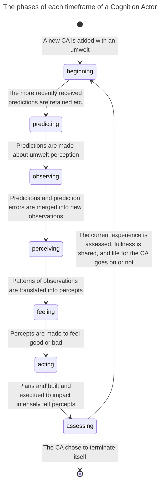
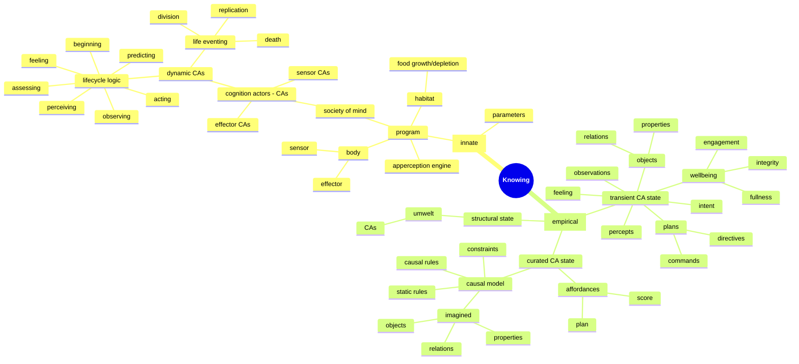

# Symposium 2026 - Who knows

Video deadline is November 7th.

Title: Who knows
Presenter: Jean-François Cloutier, Research Fellow, Active Inference Institute

## Synopsis

The Karma project asks, "How can an autonomous robot learn to survive in a world it initially knows nothing about?"

To answer this question, I am building a cognitive system (enactive, emergent and symbolic) embodied in an autonomous -and mortal- Lego robot. The robot survives in a nourishing and dissipative world by acting-sensing and finding meaning in what it experiences.

The Karma project presents many challenges, technical but also metaphysical. A primary concern is the multiplicity of perspectives on reality, that of the robot, of its (agentic) environment, of the programmer, and of observers. What can each know, and how? Is a confusion, a cross-contamination of epistemologies inevitable? With "Agentic AI" poised to transform our lives, these questions about knowing matter far beyond the programming of a Lego robot, but they can be illuminated by it.

### Outline

* Project overview
* Knowing
* Epistemic agents
* A confusion of epistemologies
* Knowing better

### Project overview

My Lego robot is autonomous and mortal. Its survival depends on it learning how to reliably find food before it starves, while avoiding damaging itself beyond repair.

The robot has a body and a mind. The body has sensors to read distance, touch, color, wheel torque etc., and it has effectors, here motorized wheels, to move about.

Its mind is an emergent and self-organizing society of processes that make sense, together, of a world the robot engages in order to survive.

Each process in the robot's society of mind is a "software actor", that is, a long-lived process that runs independently of others. It manages its own changing state and interacts with other actors strictly via messages. This Actor Model should feel intuitive as it can be applied to people, neurons, the Web etc.

The software actors composing the robot's society of mind implement the robot's cognition. They will be referred to as Cognition Actors. There are three kinds of Cognition Actors (CAs): sensor, effector and dynamic cognition actors.

Sensor and effector CAs interface with the body's physical sensors and effectors. CAs grow and evolve a hierarchy with sensor and effector CAs at the very bottom layer. Dynamic CAs form every other layer. Each dynamic CA has an umwelt it can sense and act upon. This umwelt is composed of other (child) CAs one level down. Two CAs can have umwelt CAs in common.

A dynamic CA (henceforth CA unless otherwise specified) senses its umwelt by predicting what its umwelt perceived and then combining *predictions* and *prediction errors* -sent by its umwelt- into *observations*. It find patterns in these observations and translates them into its own *percepts* (counts, up or down trends, compared quatities). A CA's percepts are then observed by its parent CAs, etc. The CAs effectively organize into an abstraction hierachy.

A CA makes sense of what it observes in its umwelt by developing a *causal model* (logic rules and constraints) that explains why certain observations change, or not, from one moment to the next. A CA uses this causal model to make accurate predictions and build effective plans so as to maintain its wellbeing.

The wellbeing of a CA is defined in terms of its fullness (energy reserve), integrity (health level) and engagement (impact on other CAs). Wellness fluctuates over the life of the CA as the robot feeds, collides, collaborates and generally expends energy. Low or declining wellness causes a CA to feel bad. The CA attaches feelings to its perception, leading to desirable vs undesirable percepts. Feelings are contagious. CAs share surplus fullness with their entourage (umwelt and parent CAs) so that the pains and gains of one are eventually felt by all.

A CA *acts* by persisting or terminating percepts, one at a time, because of how they feel. The CA achieves these self-assigned *goals* by formulating plans or by reusing *affordances* (already built plans). A plan is a sequence of goals a CA assigns to its umwelt CAs. The assigned goals are desired changes to umwelt percepts that, if realized, would persist or terminate one of CA's own percepts as intended. The child CAs formulate their own plans for impacting their percepts in the service of a parent CA. And so on, until a plan is directed at an umwelt containing effector CAs, with commands to spin wheels etc., perhaps causing the robot to avoid a collision or to position itself over food. A parent CA does not micro-manage its umwelt. In fact, umwelt CAs might give higher priority to self-assigned goals if they consider them more urgent than directives received from parent CAs.

Just as a CA's observations are acquired from predicting umwelt perception and receiving prediction errors (sent by the umwelt), a CA's actions are also realized by making predictions. A CA predicts changes to "goal activations" (action-derived percepts) in its umwelt, predictions that cause umwelt CAs to make progress in executing their own plans (also via predictions).

A CA *experiences* one extended moment after the other. Each "thick now" the CA experiences holds a coherent set of observations/sensations, wellbeing, felt percepts, causal model, goals and plans.

What a CA experiences depends, in part, on where it sits within a collective of CAs. Whether it sits there for long itsef depends on what the CA experiences in the long run.

When the robot is first activated, its society of mind begins with a set of sensor CAs (one for each sensor in the robot's body) and effector CAs (one for each effector in the robot's body). They form a permanent bottom layer. A second layer is immediately seeded with a dynamic CA that has all of the first layer CAs as its umwelt. Over time, this first dynamic CA replicates and divides, populating the second layer with randomly "specialized" CAs, each with smaller umwelts. Once the layer is full, a third layer is seeded with a dymanic CA that has the entire second layer as its umwelt, and the process continues. Growth is constrained by how much food (the ultimate source of fullness) the habitat can provide, and by the deaths of CAs when their fullness runs out or when their integrity is lost beyond repair. As the society of mind grows and shrinks and grows again, it explores a space of possible organizations, eventually finding one that favors the survival of the collective of CAs. Or the robot's mind dies trying.

For a more detailed account of Karma's cognitive architecure, see last year's presentation at ...

### Knowing

My robot is an epistemic agent. What can it know and how does it know it? I am assuming here that questions of epistemology encompass not just the realm of the living but also of the artificial, including mere Lego robots.

Everything the robot knows, at any point in time, can be located in the experiences of its collective of cognition actors.

Sensor CAs are primitive in that they simply learn what sensors read. We will focus on dynamic CAs where open-ended cognition happens.

The robot's knowledge is divided into innate vs. empirical knowledge.

#### Innate knowledge

Innate (or a priori) knowledge is programmed in. It is the logic, plus preset parameters, that drive the repeating experiential lifecyle of each CA, and each step of this lifecycle.

The steps are:

* beginning       - setting up a new lifecycle
* predicting      - making predictions about what the umwelt perceives
* observing       - merging predictions and prediction errors into observations
* perceiving      - detecting and translating patterns of current and past observations into percepts
* feeling         - assigning a normative value (from worst to best feeling) to each percept
* acting          - formulating or reusing plans to impact strongly felt percepts, and executing the plans
* assessing       - evaluating the current causal model, scoring executed plans as affordances, abandoning stale goals and plans, sharing fullness, moving on to next life event (replication, division, death, or proceeding to the next lifecycle)

The program does not contain any empirical knowledge, that is, knowledge that can be acquired by the robot experiencing its engagement with its habitat. What a CA experiences and learns at each step of its lifecycle is not fully determined by its programming.

The robot's habitat, when run in simulation mode, is itself a program. It senses the robot's position and automates the depletion and growth of "food patches" that the robot seeks to replenish itself, while presenting the robot with obstacles also preprogrammed.

#### Empirical knowledge

The robot acquires empirical (a posteriori) knowledge, that is, knowledge beyond its programming, from actively engaging its habitat in its pursuit for survival.

The robot is not pre-loaded with any concept or rule describing its habitat or what it should do in it. There is no pre-training. Furthermore, there is no communication from programmer or observer to assist the robot once it is activated.

The robot's empirical knowledge is what it acquires from experiencing its world and then uses to actively survive in it. This knowledge is distributed among the CAs that compose the robot's society of mind.

Each CA grows this empirical knowledge from experiencing and acting on its umwelt which is itself composed of other CAs growing their own empirical knowledge.

=== REVISE THIS TRANSITION ==
Experiences combine observations, percepts, wellbeing, feelings, causal models, goals and plan. Experiences change from moment to moment. Experiences are central to knowing. A CA learns perceives its umwelt in order to modify its own experience. It acts by planning how to direct its umwelt CAs to modify their perceptions and, consequently, their own experiences, in order for the CA to persist or terminate an intensely felt percept.
==

To build an effective plan, a CA needs to know two things, 1. which umwelt percepts contributed to the percept it aims to impact, and 2. knowing this, which sequence of changes to umwelt percepts is likely to cause the CA's percept to persist or terminate as intended.

A CA can make a good guess from the static analysis of what needs to change in its umwelt to change its own perception. But this may not be enough. CAs are dynamic and their percepts can change without being directed to. A CA benefits from building a *causal model* of how its umwelt changes both when prompted and on its own. A CA makes use of this causal model about its umwelt to build plans that are more likely to succeed.

A causal model is knowledge that *explains* what the CA observes in its umwelt. It is a theory formulated as static and causal rules that are discovered from a history of observations to make sense of it. The rules simulate how latent processes presumably cause what the CA observed. Static rules describe what should and should not be observed together at any moment. Causal rules describe what should be observed the next moment given what is observed at the moment. A causal model can even imagine something unobserved but needed to explain what is observed.

A causal model is how a CA *makes sense* of what it observes to more accurately predict future observations and do counter-factual reasoning when comparing alternate plans of action.

Causal models are produced by an Apperception Engine, a sub-system that, given a history of observations by a CA, will search for an economical causal model that can reproduce this history with acceptable accuracy. For more details, see my presentation from the 2024 Symposium (...)

A CA learns *affordances* (plans that work) from its experiences. After a plan is executed and because the outcome of a plan may not immediately observable, the CA stays on the lookout over its next lifecycles for evidence that the plan was effective. Was the percept meant to be persisted indeed persisted? Was the percept meant to be terminated indeed terminated? If it was, and the outcome closely follows in time the execution of the plan, then the CA can have some confidence in the plan's effectiveness. An effective plan becomes a learned affordance, to be reused later when the CA seeks to achieve the same goal.

=== REVISE THIS
To recap, a robot's empirical knowledge is acquired from embodied experience and is distributed among a collective of CAs organized in an abstraction hierarchy. Each CA:

* updates its perception by detecting patterns observed in its umwelt,
* associates feelings to what it perceives from a fluctuating wellbeing,
* sets itself the goals of persisting or terminating its most intensively felt percepts,
* builds plans that direct its umwelt CAs to impact their own perception,
* uses a causal model to infer what it can not observe in its umwelt and to anticipate the consequences of a plan,
* and reuses plans that have been shown to be effective affordances.
=====

Clearly, experiences are central to the robot acquiring knowledge. Without experiences (what is observed, inferred, created, felt, planned, impacted), no empirical knowledge of any kind is possible for the robot.

It is worth noting that the streams of sensations (sensor readings), from which all experiences stem, are contingent on the nature of the sensors and on their placements on the robot's body. The set of possible effects on which all plans depend are also contingent on the nature of the effectors (here, motorized wheels) and their placements on the robot's body. What a robot experiences and learns are a function of its specific embodiement.

This brief overview of the robot's empirical knowledge would be incomplete without mentioning how it is represented in the robot's computer memory. Unlike most machine learning systems, knowledge here is not captured as tensors (matrices of floating point numbers encoding probabilities); it is encoded symbolically.

Percepts, and thus their observations, the goals of impacting them and the plans sequencing goals, are represented in terms of binary predicates on objects. Predicates are either properties (numbers or symbols as values), or relations (objects as values).

An object can be a sensor, an effector, a goal or a set of observations that formed a pattern. It is not a physical object in the sense we humans are familiar with. Each object has a unique name, for examples `front_touch_sensor`, `infrared_sensor`, `left_wheel_effector` and `ab397f0dbb2a`. When a CA constructs an object (a goal or a set of observations), it gives it a unique name that does not make sense to humans but is perfectly adequate for the CA.

An object can have properties, each with its numeric value, and it can have relations, each with another object. Properties and relations also have names, for example `distance`, `touched`, `trend`, `count`, `more_than` and `587bcdefa30`. When a causal model introduces a new kind of property or relation that's unobserved but needed to make sense of what is observed, it gives it a unique name that need not make sense to humans.

Properties and relations look like `touched(front_touch_sensor, true)`, `distance(infrared_sensor, 120)`, `trend(ab397f0dbb2a, up)`, `more_than(4756facca, 9872ff67fe)`, or even `587bcdefa30(2bsd44500f, de53d1b4a00)`.

Causal models are small logic programs, that is, lists of if-then rules also expressed in terms of the properties and relations of objects.

The knowledge a robot acquires over time is symbolically encoded and is somewhat readable to humans (more so than gigantic matrices of floating point numbers) even though objects and predicates can be assigned names that are opaque (to us).

### Epistemic agents

My robot can be argued to be a free agent. Its program does not dictate what it ought to do next or which experiences to construct from what it senses, observes and feels. Experiences are contingent on the robot's history of interactions with its habitat, on an unpredictably evolving configuration of long-lived processes (cognition actors), and on some amount of programmed randomness.

The programming sets up the a priori forms and logic that makes possible the synthesis of open-ended empirical knowledge. It does not dictate the contents of that knowledge nor the actions that cause its acquisition.

The robot's habitat currently has no real agency. It is mostly reactive to the robot's presence and actions. However, there is no reason why the habitat could not be modified to have its own experiences, including goals and affordances so that it will seek to maximize its own flourishing, perhaps by enticing the robot into a symbiotic relationship.

The robot and (eventually) its habitat are not the only agents in the overall epistemic picture. There's the programmer (me) who is the source of the robot's innate knowledge (its program and preset parameters). There can also be observers who witness the behaviors of the robot and build a "theory of mind" to explain what they see.

Each of the robot, habitat, programmer and observers, have their own umwelt, that is, what they can perceive and what they can do to change it. As a programmer, I perceive the internal logic of the robot's programming and what the robot does, and I can alter its code. Observers don't have access to the code so but they could interfere physically with the movements of the robot with the goal of altering its behavior.

Human umwelts are obviously much richer and more complex than the umwelt of a Lego robot. However this doesn't mean that we humans have a special claim on reality while the robot, with it comparatively insignifcant cognitive faculties, doesn't. In fact, according to Immanuel Kant (and I agree), no one does.

Humans and robot are both tethered to their sensations, sensations they actively unify into transient experiences. Both actively construct causal models to make sense of what they observe to predictably alter their experiences and feel better. No one has direct access to the noumena, to "things as they are".

There is no overlap between the umwelts of humans and robots. Each have necessarily disjoint experiences. They don't even share concepts. What we have here is a multiverse of umwelts within a shared noumena.

### A confusion of epistemologies

It is remarkably difficult accept that theses universes are inherently separate and avoid a cross-contamination of epistemologies.

The programmer will be tempted to insert the concepts of "wall" and "blocked" in the robot's programming even though there is absolutely no possibility for a robot with only touch and distance sensors to conceive of a "wall" or even of physical objects in 3D space **as we do**. We humans have a different, much more sophisticated sensory and cognitive apparatus that we evolved over eons to navigate 3D space. We have profoundly different umwelts.

The robot will develop its own concepts when experiencing the spinning of its wheels while its touch sensor is pressed, the distance it senses remains unchanged and its stores of energy dwindle. We might conceive of this as being "blocked by a wall". But it will not be how the robot makes sense of it. It cannot be.

If, as a programmer, I insert concepts from my own umwelt into the programming of the robot, these concepts will be necessarily alien to it. They will get in the way of the robot building its own understanding. It will impede its survival.

Observers will likely project on the robot's behaviors a psychology familiar to them. The robot will be seen as being "afraid of a barrier", becoming "frantic from starvation", feeling "content and relaxed after a meal" etc.

Will they be wrong? Who can say? The robot-as-it-is is afterall noumenon, impossible to access directly by anyone. Observers, just like the robot or any other cognitive system, have only access to what Kant identifies as "appearances". These appearances are created by the impacts of "things as they are" on their sensorium, from light bouncing off the robot-as-it-is and hitting their retinas. Observers can only gain empirical knowledge from experiencing the robot-as-it-appears, never the robot-as-it-is. The knowledge they acquire is neither valid or invalid in the absolute, but it can be tested for its utility by making predictions.

Of course, observers could talk to the programmer who would quickly, perhaps too quickly, attempt to dispell their delusional beliefs about the robot's psychology.

### Knowing better

I am having great fun developing an embodied, enactive and symbolic cognitive architecture for my Lego robots. The objective is to gain personal insights into cognition, insights that I am happy to share. All in Feyman's joyful spirit of building to understand.

It follows that I do not use agentic AI to generate code or documentation because **I** doing the work **is** the point.

This is not the only reason I don't use LLMs. I find the indiscreminate adoption of generative AI distressing, not only because of the well-documented cognitive and environmental damage it causes, but also because of the epistemic confusion at the core of the phenomenon.

We hear that the technology has achieved or will soon achieve "free agency" and "superhuman general intelligence". Has it? Can it? Working on the Karma project has helped me make sense of the epistemic confusion responsible for the questionable and inflated claims made about both LLMs and the agentic harnesses that automate their exploitation, a.k.a. "Agentic AI".

Much has been written refuting these claims so I will keep my own refutation brief. I will not address the ill-defined claim of "superhuman general intelligence" other than by saying that general intelligence probably implies open-ended learning and adaptive problem-solving.

But first, my credo: Agency and embodied experiences are central to cognition. An agent unifies streams of sensations into coherent experiences to make sense of them and predict future sensations. The scope and meaning of these experiences are bounded by the agent's own umwelt, itself limited by what the agent can sense and do. The agent assigns feelings to its sensations to promote survivable choices: Persist what feels good and terminate what feels bad. *A free agent makes its own choices for its own good reasons.* These reasons are informed by sense-making, grounded by mortality, and motivated by the agent's drive to survive.

What does an LLM experience? An LLM trained on texts experiences the mutual proximity of lexical tokens (parts of word) within these texts. Give the LLM-in-training enough word placement experiences and it will generate surprising and coherent sentences when prompted with only a few words. Give it reiforcement training on its output and it will likely generate text in the preferred tone and style.

The LLm does not experience what the texts refer to, like the human experiences of smelling a rose or falling in love. The words an LLM ingests are mere pointers to human experiences. The words it expertly generates are also only pointers to human experiences. The pointed-to experiences are our own, they are not the experiences of the LLM.

The LLM's umwelt is not ours. An LLM's umwelt is what we, humans, write about our own umwelts. The LLM senses word proximity, not the smell of a rose or the accelerated heartbeat of a lover. To believe that the LLM understands what it generates is a clear case of epistemic confusion.

What about agency? "Agentic AI" boils down to software scripts sending text to LLMs, interpreting some of the LLM output as software commands, running these commands and, recursively, feeding their output to the LLMs. An agentic AI system can successfully be used to generate working programs (code is text), **including its own scripts**. From this, some make the leap to the inevitability of a self-improving AI eventually achieving super-intelligent agency and turning us all into paperclips.

An agentic AI system does make choices but these choices are about how to complete a text based on an LLM's prior experiences of word co-locations. The system is neither cognitive in the human sense nor truly autonomous, though it can give the illusion of it, especially when it causes widespread damage and generates text asking for forgiveness. All it does is to recursively react to incomplete texts by completing or executing them. Since it is not mortal, it has no basis for determining what choices are good vs bad for it. Agentic AI never makes choices for its own good reasons, though it can produce text that says it does.

I have gained enough insight building a cognitive architecture for my Lego robots to affirm that agentic AI, as currently designed, will never become truly agentic or generally intelligent. A different approach however might succeed, one based on embodied experiences and agency grounded in mortality.  
