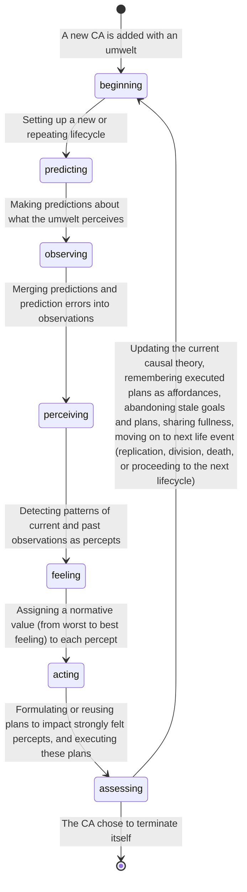

# Symposium 2026 - Who knows

Video deadline is November 7th.

Title: Who knows
Presenter: Jean-François Cloutier, Research Fellow, Active Inference Institute

## Synopsis

The Karma project asks, "How does an autonomous robot learn to survive in a world it initially knows nothing about?"

To answer this question, I am building a cognitive system (enactive, emergent and symbolic) embodied in an autonomous -and mortal- Lego robot. The robot survives in a nourishing and dissipative habitat by acting, sensing and finding meaning in what it experiences.

The Karma project presents many challenges, technical but also metaphysical. A primary concern is the multiplicity of perspectives on reality, that of the robot, of the programmer, and of observers. What can each know, and how? Is a confusion, a cross-contamination of epistemologies inevitable? With "Agentic AI" poised to transform our lives, these questions about knowing matter far beyond the programming of a Lego robot, but they can be illuminated by it.

### Outline

* Experiencing
* Knowing
* Epistemic agents
* Epistemic confusion
* Knowing better

### Experiencing

My Lego robot is autonomous and mortal. Its survival depends on it learning from its experiences how to reliably find food before it starves, while avoiding damaging itself beyond repair.

The robot has a body and a mind. The body has sensors to read distance, touch, color, wheel torque etc., and it has effectors, here motorized wheels, to move about. It inhabits a world where food can be found if obstacles are avoided.

The robot's mind is an emergent and self-organizing collective of processes that, together, experience and make sense of a world the robot engages with in order to survive and thrive. Each process in the robot's society of mind is a "software actor", that is, a long-lived process that runs independently of all others. It manages its own internal state and interacts with other actors only via messages.

The software actors composing the robot's mind implement its cognition. I will refer to them as Cognition Actors. There are three kinds of Cognition Actors (CAs): sensor CAs, effector CAs and dynamic CAs.

Sensor and effector CAs interface with the robot's physical sensors and effectors. CAs form an evolving collective organized into a hierarchy, with sensor and effector CAs at the bottom layer. Dynamic CAs compose every other layer on top. They are born and can die. Each dynamic CA has an umwelt it can sense and act upon. This umwelt is composed entirely of other (child) CAs one level down. Umwelts can overlap.

A dynamic CA (henceforth CA unless otherwise specified) observes its umwelt by predicting what the umwelt perceives. Its *observations* combine the *predictions* it emits with the *prediction errors* the umwelt sends back. An observation is either an uncontested prediction or a corrected one.

The CA find patterns in its observations and translates them into *percepts*. The types of patterns a CA detects are counts (1, 2 ,3, many) of related observations -there are 2 of these-, trends (up, down, stable) in a changing observation -this is going up-, and comparisons between observed magnitudes -this is bigger than that-. A CA's percepts are then observed by its parent CAs who may detect a trend in an observed count, count the number of observed trends etc. And so on, up an abstraction hierarchy.

A CA makes sense of what it observes in its umwelt by developing a *causal theory*. A causal theory explains why certain observations appear, change, remain or disappear from one moment to the next. A CA uses its causal theory to make better predictions and build effective plans in a bid to maintain its wellbeing.

The *wellbeing* of a CA is defined in terms of its fullness (energy reserve), integrity (health level) and engagement (impact on other CAs). Wellness fluctuates over the life of the CA as the robot feeds, collides, collaborates and generally expends energy. Low or declining wellness causes a CA to feel bad. The CA attaches feelings to its perception, leading to good vs. bad percepts. Feelings are contagious because CAs share surplus fullness with their entourage (child and parent CAs). Eventually, the pains and gains of one CA are felt by all CAs in the collective.

A CA *acts* by persisting or terminating intensely felt percepts. The CA achieves these self-assigned *goals*  one at a time by formulating plans or by reusing *affordances* (already built plans). A plan is a sequence of goals a CA assigns to its umwelt/child CAs. The assigned goals are desired changes to umwelt percepts that, if realized, would persist or terminate one of CA's own percepts as intended. The child CAs, in response, formulate their own plans for impacting their percepts in the service of a parent CA. And so on, until a plan is directed at an umwelt containing effector CAs. The plan then consists of commands to spin wheels etc., perhaps causing the robot to avoid a collision or to position itself over food. A parent CA does not micro-manage its umwelt; umwelt CAs build their own plans. In fact, umwelt CAs might give higher priority to self-assigned goals if they consider them more urgent than directives received from parent CAs.

Just as a CA's observations are the outcomes of a predictive process, a CA's actions are also realized by making predictions. A CA predicts changes to "goal activations" (action percepts) in its umwelt. Such predictions, when received, prompt umwelt CAs to build plans or make progress in executing them, also via predictions.

A CA experiences one extended moment after the other. Each "thick now" the CA experiences is a unified set of observations, wellbeing, felt percepts, causal theory, goals and plans.

What a CA experiences depends, in part, on where the CA sits within the collective of CAs. How long it sits there depends on whether the CA's experiences favor its survival.

When the robot is first activated, its society of mind starts life with a set of sensor CAs (one for each sensor in the robot's body) and effector CAs (one for each effector in the robot's body). They form a permanent bottom layer. A second layer is immediately seeded with one dynamic CA that has the entire first layer CAs as its umwelt. Over time, this first dynamic CA replicates and divides, populating the second layer with randomly "specialized" CAs, each with smaller umwelts. Once the layer is full, a third layer is seeded with a dynamic CA that has the entire second layer as its umwelt, and so on. Growth is constrained by how much food (the ultimate source of fullness) the habitat can provide to sensor CAs, and by the deaths of CAs when their (diffusing) fullness runs out or when their integrity is lost beyond repair (repair drains fullness). As the society of mind grows and shrinks and grows again, it explores a space of possible organizations, eventually finding one that favors the survival of the collective. Or the robot's mind dies trying.

For a more detailed account of Karma's cognitive architecure, see last year's presentation at ...

### Knowing

My robot is an epistemic agent. What can it know and how does it know it? I am assuming that questions of epistemology encompass not just the realm of the living but also of the artificial, including mere Lego robots.

Everything the robot knows, at any moment, can be located in the experiences of its collective of cognition actors.

Sensor CAs simply experience what the sensors read. We will focus on dynamic CAs where open-ended cognition happens.

The robot's knowledge is divided into innate and empirical knowledge.

#### Innate knowledge

Innate (or a priori) knowledge is programmed in. It is the logic, constrained by preset parameters, that drives the repeating lifecyle of a CA and each step of this lifecycle.

The steps are:

The robot's habitat, when run in simulation mode, is itself a program. It senses the robot's position and automates the depletion and growth of "food patches" that the robot seeks in order to replenish itself, while presenting the robot with obstacles, also preprogrammed.

#### Empirical knowledge

The robot acquires empirical (a posteriori) knowledge on its own by actively experiencing its habitat. It applies this contingent knowledge in its bid to survive and thrive.

The robot's innate (preprogrammed) knowledge does not contain any knowledge of its habitat or what it should do in it. There is also no pre-training before a robot is activated and no communication from programmer or observer to guide the robot once it is activated.

Empirical knowledge is distributed among the dynamic CAs that compose the robot's society of mind. Each CA has transient experiences consisting of observations (of its umwelt CAs), fluctuating wellbeing (fullness, integrity and engagement) and felt percepts (good vs bad patterns detected in its umwelt).

Empirical knowledge is distilled from past and present percepts, the CA's own and those it observed in its umwelt. The CA learns how its umwelt changes (causal theory) and how to make it change (afordances). This acquired knowledge is used to predict future observations and perceptions, and to act in ways that achieve beneficial outcomes.

It is worth noting that the streams of sensations (sensor readings), from which all percepts originate, are contingent on the nature of the sensors and on their placements on the robot's body. The set of possible effects, on which all plans depend, are also contingent on the nature of the effectors (here, motorized wheels) and their placements on the robot's body. What a robot perceives, learns and can do are thus a function of its specific embodiment.

A CA learns *affordances* (plans that work) from past experiences. A plan’s goal is an intensely felt percept to persist (if good) or terminate (if bad). The plan is a sequence of goals the umwelt is asked to achieve. After a plan is executed, the CA stays on the lookout over its next lifecycles for evidence that the plan was effective. Was the percept it intended to persist indeed persisted? Was the percept it intended to terminate indeed terminated? If it was, and the outcome closely follows in time the execution of the plan, then the CA can have some confidence in the plan's effectiveness. A proven plan becomes a learned affordance, to be remembered, reused and re-evaluated when the CA later seeks to achieve the same goal.

To build an effective plan, a CA needs to make good guesses about which sequence of changes to its umwelt is likely alter its own perception as intended. CAs are dynamic and can change without being directed or, when directed, they can change in non-immediate ways. A CA builds and revises a *causal theory* of how its umwelt changes. A CA makes use of its causal theory to carry out counterfactual reasoning and build plans that are likely to succeed and so become reliable affordances.

A causal theory is knowledge that *explains* what the CA observes in its umwelt by reproducing it more or less accurately. It is formulated as a logic program composed of static and causal rules and discovered from examining a history of observations. The rules simulate how latent processes presumably cause what the CA observes. Static rules describe what should and should not be observed together at any moment. Causal rules describe what should be observed in the next moment given what is observed in the present moment. A causal theory can even imagine something unobserved but needed in order to explain what is being observed.

Causal theories are produced by an Apperception Engine, a sub-system that, given a history of observations by a CA, will search for an economical logic program that can reproduce this history with acceptable accuracy, and thus predict a CA's incoming observations. The original Apperception Engine was developed by Richard Evans et al. at Google DeepMind. For more details, see my presentation from the 2024 Symposium (...)

This brief overview of the robot's empirical knowledge would be incomplete without mentioning how this knowledge is represented in the robot's computer memory. Unlike with most machine learning systems, knowledge is not captured as tensors (matrices of floating point numbers encoding probabilities) but is encoded symbolically.

Much of the representation of a robot's empirical knowledge comes down to how percepts are themselves represented. Affordances are plans and plans are sequences of goals where a goal is either a command to an effector or a percept to be persisted or terminated. Causal theories are logic rules about what percepts observed in a CA's umwelt must co-exist, can't co-exist or must follow in time.

Percepts, which are either sensor readings or patterns detected in observations, are encoded as binary predicates on objects. Predicates are either properties (with numbers or symbols as values), or relations (with objects as values).

Properties and relations look like these: `touched(front_touch_sensor, true)`, `color(bottom_color_sensor, green)`, `distance(front_infrared_sensor, 120)`, `trend(ab397f0dbb2a, up)`, `more(4756facca, 9872ff67fe)`, or even `587bcdefa30(2bsd44500f, de53d1b4a00)`.

Properties and relations are named, for example `distance`, `touched`, `trend`, `count`, `more` and  `587bcdefa30` (here imagined and named by a causal theory).

A property of an object has a simple value which is either a number or a symbol, for examples, `120` in `distance(front_infrared_sensor, 120)` and `up` in `trend(ab397f0dbb2a, up)`. An object can also have relations. The value of a relation is another object, for examples, `9872ff67fe` in `more(4756facca, 9872ff67fe)`and `de53d1b4a00` in`587bcdefa30(2bsd44500f, de53d1b4a00)`.

An object of a predicate can be a sensor, an effector, a goal, a set of observations forming a pattern, or an object imagined by a causal theory. It is not a physical object in the sense we humans are familiar with. Each object has a unique name, for examples, `front_touch_sensor`, `front_infrared_sensor`, `left_wheel_effector` and `ab397f0dbb2a`. A causal theory can imagine and name new objects (as well as new properties or relations) that are unobserved but are needed to make sense of what is observed. When a CA defines a new object (a goal, a set of observations or an imagined object), it gives it a unique and random name, such as `ab397f0dbb2a`. The name need not make sense to humans.

The empirical knowledge a robot acquires from actively experiencing its habitat is relatively small and is encoded symbolically. This makes it relatively easy for humans to read what a Lego robot learns, in fact much easier than reading the massive floating point matrices of Artificial Neural Networks. This does not, however, mean that the human reader will comprehend what it is like to be a Lego robot.

### Epistemic agents

My Lego robot, arguably, has agency and actively learns from experiences. The robot strives to survive and makes its own choices for its own good reasons. Its programming does not dictate what it ought to do next or what to make of what it senses, observes and feels. The programming only sets up the a priori forms and logic that make possible the synthesis of open-ended, empirical knowledge. The robot's experiences are, after all, contingent on the robot's unpredictable history of interactions with its habitat, on an evolving, adaptive configuration of long-lived processes (cognition actors), and on some amount of programmed randomness.

The robot's habitat currently has no such agency. It is mostly reactive to the robot's presence and actions. However, one could program the habitat to have its own experiences, including goals and affordances, so that it will seek to maximize its own flourishing, perhaps by enticing the robot into a symbiotic relationship.

The robot and its (eventually) agentic habitat are not the only agents in the overall epistemic picture. There's the programmer, who is the source of the robot's innate knowledge (its program and preset parameters), and observers who witness the behaviors of the robot and build "theories of mind" to explain what they see.

Each of the robot, habitat, programmer and observers, have their own umwelt, that is, what they can perceive and what they can do. As a programmer, I perceive the internal logic of the robot's programming as well as what the robot does, and I can alter its code to (indirectly) impact its behavior. Observers can't modify to the code but they could interfere physically with the visible movements of the robot with the goal of altering its behavior.

Though human umwelts are obviously much richer than the umwelt of a Lego robot, it does not follow that we humans have a special claim on reality while the robot, with it comparatively insignificant cognitive faculties, doesn't. In fact, according to Immanuel Kant -and I agree-, no one has direct access to reality.

Humans and Lego robots are equally tethered to their sensations, sensations they must unify to have experiences. Both construct causal *theories* to make sense of what they observe. No one has direct access to the noumena, to "things as they are".

There is, furthermore, no overlap between the umwelts of humans and robots. Each have necessarily disjoint experiences and they don't share concepts. What we have here is a multiverse of umwelts within a shared noumena.

### Epistemic confusion

It is remarkably difficult to accept that theses universes are inherently separate and avoid a cross-contamination of epistemologies.

The programmer will be tempted to insert the concepts of "wall" and "blocked" in the robot's programming even though there is absolutely no possibility for a robot with only touch and distance sensors to conceive of a "wall" or even of physical objects in 3D space **as we do**. We humans have a different and much more sophisticated sensory and cognitive apparatus, one that we've evolved over eons to navigate 3D space. We and robots have profoundly different umwelts.

The Lego robot develops its own concepts when, for example, it spins its wheels, senses its touch sensor being pressed, and perceives distance as unchanging, all while its energy reserves dwindle. We might imagine the robot experiencing being "frustratingly blocked by a wall". But it will not be how the robot can make sense of it. If, as a programmer, I insert concepts from my own umwelt into the programming of the robot, these concepts will necessarily be alien to it. They will get in the way of the robot building its own coherent understanding. It will impede its survival.

Observers will likely project on the robot's behavior a psychology that's familiar to them. They might see the robot as being "afraid of the wall", becoming "frantic from starvation", feeling "content and relaxed after a meal" etc.

Will they be wrong? Who can say? The robot-as-it-is is afterall noumenon, impossible to access directly by anyone. Observers, just like the robot or any other cognitive system, have only access to what Kant identifies as "appearances". These appearances are created by the impacts of "things as they are" on their sensorium, here, from light bouncing off the robot-as-it-is and hitting an observer's retinas. Observers can only gain empirical knowledge about the robot from experiencing the robot-as-it-appears, never the robot-as-it-is.

The knowledge they acquire is neither valid nor invalid in the absolute, but it can be tested for its utility by making predictions about future behaviors. Of course, observers could talk to the programmer who would quickly, perhaps too quickly, attempt to dispell their "delusional" beliefs about the robot's psychology.

### Knowing better

I am having great fun developing an embodied, enactive and symbolic cognitive architecture for my Lego robots. My objective is to gain personal insights into cognition, insights that I am happy to share. All in Feyman's joyful spirit of building to understand.

It logically follows that I **do not** use agentic AI to generate code or documentation because **I** doing the work **is** the point.

There are other reasons I don't use LLMs. I find the indiscriminate adoption of generative AI distressing, not only because of the well-documented cognitive and environmental damage it causes, but also because of the epistemic confusion at the core of the phenomenon.

We hear that the technology has achieved, or will soon achieve, "free agency" and "superhuman general intelligence". Has it? Can it? Working on the Karma project has helped me make sense of the epistemic confusion responsible for the questionable and inflated claims made about both LLMs and the agentic harnesses that automate their exploitation, a.k.a. "Agentic AI".

Much has been written refuting these claims so I will keep my own refutation brief. I will not address the ill-defined claim of "superhuman general intelligence" other than to say that general intelligence implies open-ended learning and adaptive problem-solving.

But first, my credo: Agency and embodied experiences are central to cognition. An agent unifies streams of sensations into coherent experiences to make sense of them, predict future sensations and plan actions. The scope and meaning of these experiences are bounded by the agent's own umwelt, itself defined by what the agent can sense and do. The agent assigns feelings to its perceptions to promote survivable choices: To live, persist what feels good and terminate what feels bad. *A free agent makes its own choices for its own good reasons.* These "good reasons" are informed by sense-making, grounded by mortality, and motivated by the agent's drive to survive. End of credo.

What does an LLM experience? An LLM trained on texts experiences the *mutual proximity of lexical tokens* (parts of word) within these texts. Give the LLM-in-training enough word placement experiences and it will generate coherent sentences when prompted with a few words. Give it reinforcement training on its output and it will likely generate text in the preferred tone and style.

This is quite extraordinary but *the LLm does not experience what the texts refer to*, such as the human experiences of smelling a rose or falling in love. The words an LLM ingests are pointers to human experiences. The words it expertly generates are also pointers to human experiences. The pointed-to experiences are our own. They are not the experiences of the LLM.

An LLM's umwelt is made up of what we, humans, express about our own umwelts. The LLM's umwelt is not ours. The LLM senses word proximity, not the smell of a rose or the accelerated heartbeat of a lover. To believe that the LLM understands what it generates is a clear case of epistemic confusion.

What about agency? "Agentic AI" systems boil down to software scripts sending text to LLMs, interpreting some of the LLM's text response as software commands, running these commands and, recursively, feeding their output to the LLMs. An agentic AI system can be used to generate working programs (code is text), **including its own scripts**. From this, some make the leap to the inevitability of a self-improving AI eventually achieving super-intelligent agency and turning us all into paperclips.

An agentic AI system makes choices but these choices are about how to complete prompts based on an LLM's prior experiences of word proximity. The system is neither cognitive in the human sense nor truly autonomous, though it can give the illusion of it, especially when it causes widespread damage from unfettered access to the Web and then generates words about forgiveness. All it does however is recursively react to incomplete text by completing it with more text. Since it is not mortal, it has no basis for determining what choices are good vs bad for it. Agentic AI never makes choices for its own good reasons, though it can produce text that says it does.

From insights gained building a cognitive architecture for Lego robots, I believe that Agentic AI systems, as currently conceived, will never become free agents or achieve general intelligence. A different approach, however, might eventually succeed, one based on embodied experiences grounded in mortality.
