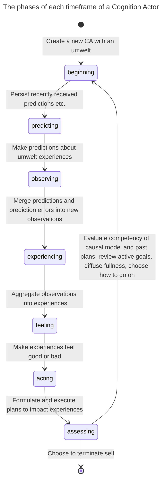
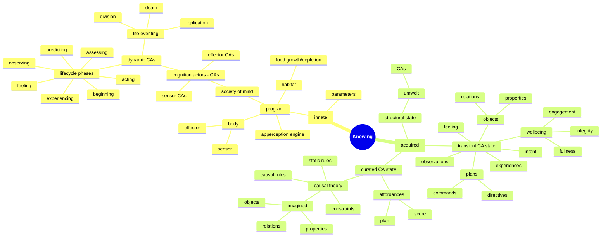

# Symposium 2026 - Who knows

Video deadline is November 7th.

Title: Who knows
Presenter: Jean-François Cloutier, Research Fellow, Active Inference Institute 

## Synopsis

My research project asks, "How can an autonomous robot learn to survive in a world it initially knows nothing about?"

To answer this, I am building a cognitive system (enactive, emergent and symbolic) embodied in an autonomous -and mortal- Lego robot. The robot survives in a nourishing and dissipative world by acting-sensing and finding meaning in what it experiences.

This project presents many challenges, technical but also metaphysical. A primary concern is the multiplicity of perspectives on "reality", that of the robot, of its (agentic) environment, of the programmer, and of observers. What can each know, and how? Is a confusion, a cross-contamination of epistemologies inevitable? With "agentic AI" poised to transform our lives, these questions about knowing matter far beyond the programming of a Lego robot, but they can be illuminated by it.

### Outline

* Project overview
* Knowing
* Epistemic agents
* A confusion of epistemologies
* Knowing better

### Project overview

My robot is autonomous and mortal. Its survival depends on it learning how to reliably find food before it starves, while avoiding damaging itself beyond repair.

The robot has a body and a mind. The body has sensors to read distance, touch, color, wheel torque etc., and it has effectors to move about.

The mind is a growing/shrinking/self-organizing society of processes that try to make sense, together, of a world the robot must engage with to survive.

Each process in the robot's society of mind is a software actor, that is, a long-lived process that manages its changing state and interacts with other actors strictly via communications. This Actor Model should feel intuitive as it can be applied to people, neurons, the Web etc.

The software actors composing the robot's society of mind implement the robot's cognition. They will be referred to as Cognition Actors.

There are three kinds of Cognition Actors, sensor, effector and dynamic cognition actors. Sensor and effector CAs interface with the body's sensors and effectors.

CAs form a hierarchy with sensor and effector CAs at the very bottom layer. Dynamic CAs form every other layer. Each such CA has an umwelt (what they can sense and act upon) and it is composed of other (child) CAs one level down. Two CAs can have umwelt CAs in common.

A dynamic CA *observes* what its umwelt *experiences*. It observes by predicting umwelt experiences and then combining predictions with prediction errors received into observations. It finds patterns in these observations and translates these observed patterns into its own experiences. A CA's experiences are then observed by its parent CAs, etc.

The wellbeing of a dynamic CA is defined in terms of its fullness (energy reserve), integrity (health level) and engagement (impact on other CAs). Wellness fluctuates over the life of the CA as the robot feeds, collides, collaborates and generally expends energy. Low or declining wellness causes the CA to feel bad. The current feeling attaches to experiences, leading to good vs bad experiences.

A dynamic CA *acts* by persisting or terminating one of its experiences because of how the experience feels. The CA does it by formulating a plan by which it directs its child CAs to change some of their own experiences, experiences the CA observed and translated into the experience it currently has and wants to persist or terminate. The child CAs formulate their own plans for impacting their own experiences in the service of the parent CA, and so on until an umwelt contains effector CAs to which commands are sent to turn wheels etc.

For a more detailed account of the cognitive architecure of my robots, see last year's presentation at ...

### Knowing

What can my robot know and how does it know it? I am assuming that questions of epistemology encompass the artificial realm, including mere Lego robots.

Everything the robot knows at any point in time can be located in the state of its collective of Cognition Actors.

Sensor CAs are primitive in that they simply learn what the sensors read. We will focus on dynamic CAs where open-ended cognition happens.

The robot's knowledge is first divided between innate vs. acquired.

#### Innate knowledge

Innate (or a priori) knowledge is what I programmed in. It is the logic that drives a dynamic CA's lifecyle and each steps it goes through repeatedly, constrained by preset parameters.

The steps are:

* beginning         - "house cleaning" at the start of a lifecycle
* predicting       - make predictions from current observations
* observing       - merge predictions and prediction errors into new observations
* experiencing    - integrate current and past observations into terminated, updated and new experiences
* feeling          - assign a normative value (from worst to best feeling) to each experience
* acting           - formulate, accept and prioritize goals to impact strongly felt experiences, make plans to achieve goals and execute them
* assessing        - evaluate causal theory and request new one if unsatisfactory, evaluate executed plans as affordances from whether and when their goals were achieved, abandon stale goals, update and diffuse wellbeing fullness (create cognitive glue), mitosis/apoptosis

What a CA learns (a posteriori) at each step is not fully determined by its programming. The programming excludes all empirical knowledge, that is, knowledge that could be acquired by the robot through embodied engagement with its habitat.

The robot's habitat, when run in simulation mode, is itself a program that senses the robot's position and automates the depletion and growth of "food patches" the robot seeks to replenish itself, while presenting obstacles also programmed into the habitat.

#### Acquired knowledge

The robot acquires all knowledge beyond its programming entirely on its own.

The robot is not pre-loaded with any concept or rule describing its habitat or what it should do in it. As we will discuss later, they would be alien to the robot's cognition. So there is no pre-training. Furthermore, there is no communication between programmer or observer to assist the robot once it is activated in its habitat.

The robot's knowledge is a manifold of experiences, feelings, causal models and affordances. This knowledge is distributed among the CAs that compose the robot's society of mind.

Each CA develops and updates its own experiences, feeling, causal model and affordances in the context of its umwelt which is composed of other CAs that are one level down an abstraction hierarchy.

Experiences are central to knowing. A CA observes the experiences of its umwelt CAs to acquire its own experiences from patterns it detects (it counts, finds up or down trends, compares quatities). It then acts to change its own experiences by directing its umwelt CA to modify experiences it observed.

Just like a CA's observations are acquired via predictions (of umwelt experiences) and prediction errors (from the umwelt), a CA's actions are executed by predicting changes to observed umwelt experiences, predictions that cause umwelt CAs to build their own plans and execute them (also via predictions).

A CA's fluctuating wellbeing changes how it feels and whether its current experiences are good ones or bad ones. A CA's attention is on the most intensly felt experiences and it sets its intent on persisting the best experiences and terminating the worst ones.

Having set for itself the goal of changing a current experience, a CA will build (or reuse) a plan of action. This plan is a sequence of directives, with each directive being a goal assigned to the umwelt to persist or terminate an observed experience. A directive can also be a command to carry out an effect (e,g, reverse-spin the left wheel) if the CA connects to an effector. How the umwelt CAs realize the goals they are assigned by their parent CAs is up to them (no micro-management!). Umwelt CAs might even give higher priority to self-assigned goals if they consider them more urgent.

To build an effective plan for impacting one of its (intensely felt) experiences, a CA needs to know two things, 1. which observed umwelt experiences contributed to the experience, and 2. knowing this, which changes to umwelt experiences in what order is likely to cause the CA's experience to persist or terminate as intended.

A CA can make a good guess from the static analysis of observed umwelt experiences compsing the experience it has and wants to change. But this may not be enough. CAs are dynamic and their experiences can change without being directed to. A CA benefits from building a causal theory of how its umwelt changes both when prompted and on its own. A CA can make use of a causal model of its umwelt to build plans that are most likely to succeed.

A causal model is a set of static and causal rules discovered from a history of observations to make sense of them. Static rules describe what should and should not be observed together at any moment. Causal rules describe what should be observed the next moment given what is observed at the moment. A causal model can even imagine something unobserved but necessary to explain what is observed.

A causal model is how a CA *makes sense* of what it observes and how it can do counter-factual reasoning to compare alternative plans of action.

Causal models are produced by an Apperception Engine, a sub-system that, given a history of a observations, will look for an economical causal theory that can reproduce this history with acceptable accuracy. Given current observations, a causal theory will not only predict what happens next with some confidence but also what provide what could not be observed but is likely true. For more details, see this presentation from the 2024 Symposium (...)

After a plan is executed, the CA stays on the lookout over the next lifecycles for evidence that the plan was effective; the outcome of a plan may not immediately observable. Was the experience meant to be persisted indeed persisted? Was the experience meant to be terminated indeed terminated? If it was, and the outcome closely follows in time the execution of the plan, then the CA can have some confidence in the plan's effectiveness. Effective plans are remembered as **affordances** to be reused later when the CA seeks similar goals.

To recap, a robot's acquired knowledge is a manifold, and it is distributed among the CAs that compose an abstraction hierarchy where CAs make up the umwelt of more abstract CAs. Each CA

* updates its experiences by detecting patterns of experiences observed in its umwelt,
* associates feelings to these experiences from a fluctuating wellbeing,
* sets itself the goals of persisting or terminating the most intensively felt experiences,
* builds plans that do so by altering umwelt experiences,
* uses a causal theory that anticipates consequences of a plan,
* and reuses plans that have shown to be effective affordances.

Clearly, experiences are central to the robot's acquisition of knowledge. Without experiences (observed, created, felt, impacted), no empirical knowledge of any kind is possible for the robot. Experience is central to knowing and it is hard won.

It is worth noting that the stream of sensations (sensor readings) from which all experiences stem are contingent on the nature of the sensors and their placements on the robot's body. The set of possible effects on which all actions depend are also contingent on the nature of the effectors (here, motorized wheels) and their placements on the robot's body. The robot's experiences are clearly dependent on its specific embodiement.

This brief overview of the robot's acquired knowledge would be incomplete without mentioning how it is represented in the robot's computer memory. Unlike most machine learning systems, knowledge here is not captured as tensors (matrices of floating point numbers encoding probabilities). It is encoded symbolically.

Experiences (and thus observations thereof) are represented as binary predicates on objects. Predicates are either properties (numbers or symbols as values), or relations (objects as values).

An object can be a sensor, an effector, a goal or a set of observations forming a pattern. It is not a physical object in the sense we humans are familiar with. Each object has a unique name, for examples `front_touch_sensor`, `infrared_sensor`, `left_wheel_effector` and `ab397f0dbb2a`. When a CA constructs an object (a goal or a set of observations), it gives it a unique name that does not make sense to humans but is perfectly adequate for the CA.

An object can have properties each with its numeric value, and it can have relations, each with another object. Properties and relations also have names, for example `distance`, `touched`, `trend`, `count`, `more` and `587bcdefa30`. When a causal theory introduces a new kind of property or relation that's unobserved but needed to make sense of what is observed, it gives it a unique name that need not make sense to us humans.

Properties and relations look like `touched(front_touch_sensor, true)`, `distance(infrared_sensor, 120)`, `trend(ab397f0dbb2a, up)`, `more(4756facca, 9872fffe)`, or even `587bcdefa30(2bsd4500f, de53d4a00)`.

Causal theories are small logic programs, that is, lists of if-then rules expressed in terms of properties and relations.

The knowledge a robot acquires over time is symbolically encoded and somewhat readble to humans (more so than gigantic matrices of floating point numbers) though objects and predicates representing experiences and causal theories can have names that are opaque (to us).

### Epistemic agents

The robot arguably has a degree of agency. Its program does not dictate what it ought to do next or which experiences to construct from what it senses, observes and feels. Experiences, feelings and actions are contingent on the robot's history of interactions with its habitat, on an unpredictably evolving configuration of long-lived processes (cognition actors), and on a degree of built-in randomness, both internal and from the habitat.

The programming provides for the forms and logic that makes possible the synthesis of open-ended empirical knowledge. It does not dictate the contents of that knowledge nor the actions that trigger its acquisition.

The robot's habitat currently has no real agency. It is mostly reactive to the robot's presence and actions. However, there is no reason why the habitat could not be expanded to have its own experiences, goals and affordances so that it will seek to maximize its own flourishing, perhaps by enticing the robot into a symbiotic relationship.

The robot and (eventually) its habitat are not the only agents in the overall epistemic picture. Thetre's the programmer (me) is the source of the robot's innate knowledge (its program and preset parameters). And there are possibly observers who look at the externally observable behaviors of the robot and build a "theory of mind" to explain what they see.

Each agent, robot, habitat, programmer and observers, have their own umwelt, that is, what they can perceive and what they can do to change what they perceive. As a programmer, I perceive the internal logic of the robot's programming and can alter it. Observers can not do so but they could interfere physically with the movements of the robot with the goal of changing its behavior.

Human umwelts are obviously richer and more complex than the umwelt of the robot or of its habitat. However this doesn't mean that humans have a claim on reality but the robot, with it comparatively insignifcant cognitive faculties, doesn't. In fact, according to Immanuel Kant (and I agree), no one does.

Humans and robot both are tethered to their sensation, sensations they actively unify into momentary experiences. Both actively construct causal theories to make sense of what they observe in order to predictably alter their experiences to feel better. No one has direct access to the noumena, to "things as they are".

There can be no overlap between the umwelts of humans, robot and habitat. Each have necessarily disjoint experiences and causal theories. They don't even share concepts.

What we have here is a multiverse of umwelts within a shared noumena.

### A confusion of epistemologies

Ideally.

It is remarkably difficult to avoid a cross-contamination of epistemologies.

The programmer (me) will be tempted to insert the concepts of "wall" and "blocked" in the program of the robot even though there is absolutely no possibility for a robot with only touch and distance sensors to conceive of a "wall" or even of physical objects in 3D space **as we do**. We have a different, much more sophisticated sensory and cognitive apparatus that we developed to navigate 3D space. We have profoundly different umwelts.

The robot will develop its own concepts from experiencing spinning its wheels while the touch sensor is pressed, distance remains unchanged and stored energy dwindles. We might recognize something akin to our concept of "blocked by a wall" but it will not be that. It cannot be that.

If, as a programmer, I insert concepts from my own umwelt into the programming of the robot, these concepts will be necessarily alien to it. They will only get in the way of the robot developing a consistent and effective model of itself in its habitat. It will impede its survival.

Observers will likely see in the robot's behaviors the workings of a psychology familiar to them. The robot will be seen as being afraid of a barrier, becoming frantic from starvation, feeling content and relaxed after a meal etc.

Will they be wrong? Not necessarily. The robot-as-it-is is noumenon. Observers, just like the robot or any cognitive system, only have access to what Kant identifies as "appearances", sensations they unify into experiences that lead to empirical knowledge. Until observers test their hypotheses about the robot's motives and state of mind, the validity of this empirical knowledge about the robot remains undetermined.

Of course, observers could talk to the programmer who would quickly, perhaps too quickly, attempt to dispell their beliefs about the robot.

### Knowing better

I take pleasure in developing an experience-based cognitive architecture for my Lego robots. I entertain no delusions (well, almost none) about the scientific value of the work. The goal has always been and remains to provide myself with challenges that gain insights into cognition, insights that I am happy to share. All in Feyman's spirit of building to understand.

I do not use agentic AI to generate code or to document my work because I doing it myself is the point.

Speaking of LLMs, I actually find their growing adoption distressing because of the widespread epistemic damage they cause. This project has helped me make some sense of the epistemic confusion behind the misinformed adoption of LLMs.
