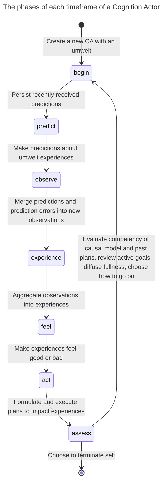
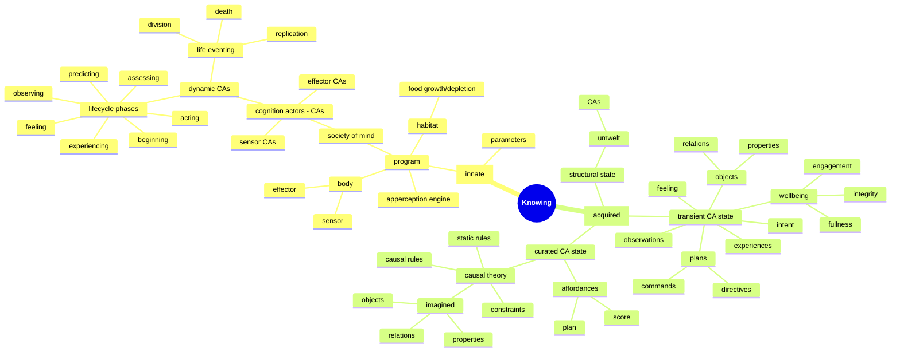

# Symposium 2026 - Who knows

Video deadline is November 7th.

Title: Who knows
Presenter: Jean-François Cloutier, Research Fellow, Active Inference Institute 

## Synopsis

My research project asks, "How can an autonomous robot learn to survive in a world it initially knows nothing about?"

To answer this, I am building a cognitive system (enactive, emergent and symbolic) embodied in an autonomous -and mortal- Lego robot. The robot survives in a nourishing and dissipative world by acting-sensing and finding meaning in what it experiences. 

This project presents many challenges, technical but also metaphysical. A primary concern is the multiplicity of perspectives on "reality", that of the robot, of its (agentic) environment, of the programmer, and of observers. What can each know, and how? Is a confusion, a cross-contamination of epistemologies inevitable? With "agentic AI" poised to transform our lives, these questions about knowing matter far beyond the programming of a Lego robot, but they can be illuminated by it.

### Outline

* Project overview
* Knowing
* Epistemic agents
* Epistemic mirages
* Building the Karma system
* Avoiding epistemic traps
* Knowing better

### Project overview

My robot is autonomous and mortal. Its survival depends on it learning how to reliably find food before it starves, while avoiding damaging itself beyond repair.

The robot has a body and a mind. The body has sensors to read distance, touch and color, and it has effectors to move about.

The mind is a growing/shrinking/self-organizing society of processes that try to make sense, together, of a world the robot must engage with to survive.

Each process in the robot's society of mind is a software actor, that is, a long-lived process that manages its changing state and interacts with other actors strictly via messages. This Actor Model should be familiar. It can be applied to people, neurons, the Web etc.

The software actors composing the robot's society of mind implement the robot's cognition. They will be referred to as Cognition Actors.

There are three kinds of Cognition Actors, sensor, effector and dynamic cognition actors. Sensor and effector CAs interface with the body's sensors and effectors.

CAs form a hierarchy with sensor and effector CAs at the very bottom layer. Dynamic CAs form every other layer. Each such CA has an umwelt (what they can sense and act upon) and it is composed of other (child) CAs one level down. Two CAs can have umwelt CAs in common.

A dynamic CA *observes* what its umwelt *experiences*. It observes by predicting umwelt experiences and then combining predictions with prediction errors received into observations. It finds patterns in these observations and aggregates them as its own experiences. Its experiences and then observed by parent CAs, etc.

The wellbeing of a dynamic CA is defined in terms of its fullness (energy), integrity (health) and engagement (participation). Wellness fluctuates over the life of the CA as the robot feeds, collides, collaborates and generally expends energy. Low or declining wellness causes the CA to feel bad. The current feeling attaches to experiences, leading to good vs bad experiences.

A dynamic CA *acts* by persisting or terminating one of its experiences because of how they feel. The CA does it by formulating a plan by which it directs its child CAs to create, persist or terminate some or all of the observed experiences it aggregated into the experience it want to impact. The child CAs formulate their own plans for impacting their own experiences in the service of the parent CA, and so on until an umwelt contains effector CAs to which commands are sent to turn wheels etc.

For a more detailed account of the cognitive architecure of my robots, see last year's presentation at ...

### Knowing

What can my robot know and how does it know it?

Everything the robot knows at any point in time can be located in the state of its collective of Cognition Actors.

Sensor CAs are primitive in that they simply learn what the sensors read. We will focus on dynamic CAs where open-ended cognition happens.

The robot's knowledge is either innate or acquired.

#### Innate knowledge

Innate knowledge is what I programmed in. It is the logic of each dynamic CA's lifecyle and the steps it goes through repeatedly, constrained by preset parameters.

The steps are:

* begin         - "house cleaning" at the start of a lifecycle
* predict       - make predictions from current observations
* observe       - merge predictions and prediction errors into new observations
* experience    - integrate current and past observations into terminated, updated and new experiences
* feel          - assign a normative value (from worst to best feeling) to each experience
* act           - formulate, accept and prioritize goals to impact strongly felt experiences, make plans to achieve goals and execute them
* assess        - evaluate causal theory and request new one if unsatisfactory, evaluate executed plans as affordances from whether and when their goals were achieved, abandon stale goals, update and diffuse wellbeing fullness (create cognitive glue), mitosis/apoptosis

The robot's habitat, when run in simulation mode, is itself a program that senses the robot's position and automates the depletion and growth of "food patches" the robot seeks to replenish itself, while presenting obstacles also programmed into the habitat.

#### Acquired knowledge

The robot acquires all knowledge beyond its programming entirely autonomously.

Experience is central to knowing. Experience is hard won.

### Epistemic agents

Robot, habitat, observer, programmer.

A multiverse of umwelts in a shared noumenon 

### Epistemic mirages

Does the robot see obstacles? Or even physical objects in 3D space as we do?

### Building the Karma system

### Avoiding epistemic traps
Subverting agency.
What does an LLM experience?

### Knowing better